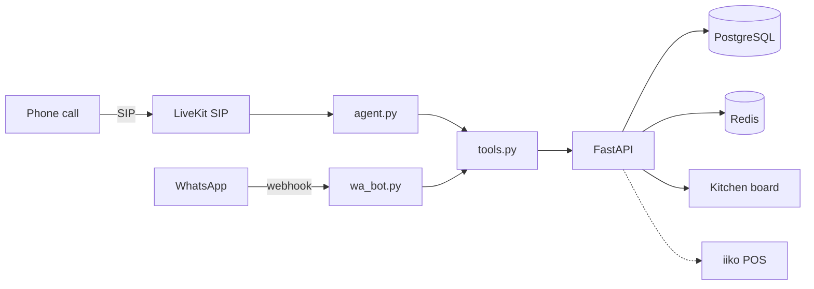

# Voice Ordering Agent

An AI phone agent that takes food delivery orders in Russian. It answers the
call, works out what the guest wants, upsells once, collects the address and
payment method, and creates the order on a kitchen board — replacing the
operator on the line.

Built for a delivery service in Makhachkala, Russia, and running on their live
phone number.

**Stack:** Python 3.12 · LiveKit Agents · FastAPI · PostgreSQL · Redis · Docker

[Русская версия](README.ru.md)

---

## Demo

> *Recording of a live call — to be added.*

Kitchen board, phone and WhatsApp orders side by side:

> *Screenshot — to be added.*

---

## Problem

- A delivery service loses orders whenever the operator is busy, off shift, or
  the line is engaged during a rush.
- Hiring a second operator costs more than the margin on the calls they'd catch.
- Off-the-shelf voice bots read a fixed IVR tree; guests hang up on them.
- The owner already has a sales script that works — it just needs someone to
  follow it on every call, including at 11pm.

---

## How it works



Both channels go through the same tool layer and the same sales script, so a
change to the script applies to phone and chat at once.

`agent.py` runs the voice pipeline: speech to text, an LLM with function
calling, text to speech. It holds no menu knowledge — every dish name and price
comes from a tool call.

`FastAPI` owns the order: menu search with pronunciation aliases, the draft in
Redis during the call, and the final order written to PostgreSQL. Prices are
re-read from the database at confirmation rather than trusted from the draft.

`iiko` is the restaurant's POS. The integration is written but not connected —
see Limitations.

---

## Quick start

**Requires:** Docker, Docker Compose. API keys for OpenAI at minimum.

```bash
git clone https://github.com/nurzhan2/voice-agent.git
cd voice-agent
cp .env.example .env      # fill in keys
docker compose up --build
```

The admin panel comes up at `http://localhost:8000/admin`, the API docs at
`/docs`. Without telephony configured you can still talk to the agent from the
terminal:

```bash
cd agent && python chat.py     # text conversation, same script and tools
```

### Environment variables

| Variable | Required | What it does |
|---|---|---|
| `OPENAI_API_KEY` | yes | the model that drives the conversation |
| `DATABASE_URL` | yes | PostgreSQL connection string |
| `BACKEND_TOKEN` | yes | protects the API and the admin panel |
| `DEEPGRAM_API_KEY` | no | streaming speech recognition; falls back to OpenAI, slower |
| `ELEVENLABS_API_KEY` + `ELEVENLABS_VOICE_ID` | no | natural voice; falls back to OpenAI TTS |
| `LIVEKIT_URL` / `_API_KEY` / `_API_SECRET` | for phone | LiveKit Cloud or self-hosted |
| `NOVOFON_SIP_*` | for phone | SIP trunk credentials |
| `WAZZUP_API_KEY` | for WhatsApp | messaging gateway |
| `IIKO_API_LOGIN` | no | POS integration; orders stay in the panel without it |

Every optional key degrades gracefully — the agent logs what it fell back to
and keeps running.

---

## Structure

```
agent/
├── agent.py        voice pipeline, tool definitions, latency tuning
├── wa_bot.py       WhatsApp: webhooks, per-chat locking, deduplication
├── prompts.py      sales script, assembled from restaurant settings
├── tools.py        tool schemas and backend client, shared by both channels
├── smoke.py        automated checks
└── chat.py         text-mode conversation for cheap script iteration
backend/app/
├── main.py         order API, admin panel, delivery-zone and hours checks
├── db.py           menu sync from YAML, trigram search over aliases
├── drafts.py       in-call order state in Redis
├── iiko.py         POS integration
└── admin.html      kitchen board
scripts/
├── deploy.sh       provisions a bare Ubuntu server end to end
└── setup_livekit.sh  registers the SIP trunk and dispatch rule
menu.yaml           170 dishes, ~470 pronunciation aliases, restaurant settings
```

---

## Decisions and trade-offs

**The menu never enters the prompt.** The obvious approach is to paste the menu
into the system prompt. In production the model then offers dishes that don't
exist — in one real call it suggested soy sauce, the guest picked it, and the
order couldn't be created. Instead the agent is told it does not know the menu:
names and prices come only from tool calls, and items are added **by database
ID**. An invented dish has no ID, so `add_item` rejects it. The cost is an extra
round trip per turn, which shows up as latency. Worth it — a bot that invents
menu items is worse than no bot.

**Constraints ride along with tool results.** Search responses carry a field
telling the model the list is complete and nothing may be appended to it. The
same rule sitting in the system prompt was ignored regularly; attached to the
tool output it holds. Less elegant than one authoritative prompt, but it
survives contact with a real conversation.

**Two guards on order confirmation instead of one.** `confirm_order` requires
an explicit consent flag plus the guest's verbatim words, and the backend
re-checks server-side. Redundant by design: the model once confirmed an order
immediately after the guest answered a question about payment. Client-side
validation of an LLM's judgement isn't validation.

**Self-hosted SIP rather than the managed service.** The hosting provider
blocks UDP 5060 and only unblocks it for registered legal entities with telecom
paperwork. Running the SIP bridge on 5080 avoided weeks of process, and also
fixed asymmetric RTP — the cloud service advertised one IP in SDP while sending
media from another, which the carrier silently dropped. The trade-off is one
more component to operate.

---

## Debugging notes

Two problems that took longer than the code did.

**One-way audio.** Calls connected, the guest heard the bot, the bot heard
nothing. The carrier insisted their recordings were fine. A packet capture
settled it:

```
LiveKit → carrier :  1096 RTP packets, full payload
carrier → LiveKit :    25 RTP packets, 12 bytes each
```

Twelve bytes is an RTP header with zero audio. Half a second of empty packets,
then silence. Identical on G.722 and PCMU, which ruled out codec negotiation
and pointed at the carrier's media path.

**Four-second replies.** Instrumenting each stage — end-of-utterance delay,
time to first token, time to first byte — showed where it actually went.
Prewarming the VAD model (every call spawned a fresh process and reloaded
Silero from disk), capping tool steps per turn (tools run sequentially, each
adding a round trip), enforcing `max_completion_tokens`, and playing keyboard
typing during tool calls. The last one changes no timing at all — a filled
pause simply reads as much shorter, and an order-taker typing is what a caller
expects to hear.

---

## Tests

```bash
make smoke        # 21 API checks: search, pricing, delivery zone, order guards
make smoke-llm    # eleven-turn dialogue against the live model
make wa-test      # replays Wazzup webhooks without touching WhatsApp
```

`smoke-llm` asserts on conversational behaviour, not exceptions: no banned
phrases from the client's script, upsell attempted exactly once, address
validated, and the order **not** created before the guest agreed. That last
assertion exists because a real call failed it.

There are no unit tests — see Limitations.

---

## Deploy

A single Ubuntu VPS, provisioned by one script:

```bash
scp -r . root@SERVER:/opt/voice-agent
ssh root@SERVER
cd /opt/voice-agent && cp .env.example .env && nano .env
bash scripts/deploy.sh
```

`deploy.sh` installs Docker, refuses to continue while placeholder passwords
are still in `.env`, opens the firewall, brings up nine containers, registers a
systemd unit for restart-on-boot, and schedules nightly PostgreSQL dumps with
14-day rotation. Caddy issues TLS automatically.

Telephony is a separate overlay, because it only applies when SIP is
self-hosted:

```bash
docker compose -f docker-compose.yml -f livekit-sip.yml up -d
bash scripts/setup_livekit.sh
```

Deployment is manual. No CI.

---

## Limitations

- **Single restaurant.** Menu, settings and orders have no tenant scoping.
  Serving a second location needs a schema change and per-number routing.
- **Russian only.** The prompt, aliases and voice are all Russian-specific.
- **No unit tests.** Coverage is integration-level; a broken helper surfaces as
  a failed smoke run rather than a precise failure.
- **No CI.** Tests are run by hand before deploying.
- **POS integration unverified.** The iiko client is written but has never
  exchanged a request with a live account — credentials are still pending.
  Orders accumulate in the panel and reach the manager over WhatsApp instead.
- **Latency depends on the LLM round trip.** Each tool call adds one. Capping
  tool steps limits the worst case, it doesn't remove it.
- **The agent trusts speech recognition.** A misheard street name is confirmed
  back to the guest, which usually catches it — but nothing validates the
  address against a real map.

---

## What's next

- Tenant scoping, so one deployment can serve several restaurants — the largest
  and most obvious gap.
- Connect iiko once credentials arrive; orders currently need manual entry into
  the POS.
- Alias tuning from real call transcripts. The admin panel already stores them;
  recognition quality depends on aliases more than on any model setting.
- CI running the smoke suite on push.

---

## License

MIT
