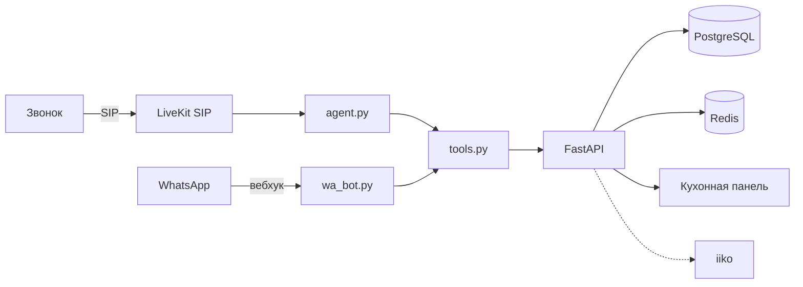

# Голосовой агент приёма заказов

Голосовой ИИ-агент, который принимает заказы на доставку еды по телефону.
Отвечает на звонок, выясняет, чего хочет гость, один раз допродаёт, собирает
адрес и способ оплаты и создаёт заказ на кухонной панели — заменяя оператора
на линии.

Сделан для службы доставки в Махачкале, работает на их боевом номере.

**Стек:** Python 3.12 · LiveKit Agents · FastAPI · PostgreSQL · Redis · Docker

[English version](README.md)

---

## Демо

> *Запись живого звонка — будет добавлена.*

Кухонная панель с заказами из телефона и WhatsApp:

> *Скриншот — будет добавлен.*

---

## Проблема

- Служба доставки теряет заказы, когда оператор занят, не на смене или линия
  забита в час пик.
- Второй оператор стоит дороже, чем маржа с тех звонков, которые он поймает.
- Готовые голосовые боты читают жёсткое меню IVR, гости бросают трубку.
- У владельца уже есть работающий скрипт продаж — нужен тот, кто будет
  соблюдать его на каждом звонке, включая одиннадцать вечера.

---

## Как устроено



Оба канала идут через один слой инструментов и один скрипт продаж — правка
скрипта применяется сразу к телефону и переписке.

`agent.py` ведёт голосовой конвейер: распознавание, модель с вызовом функций,
синтез речи. Меню он не знает: каждое название и цена приходят из вызова
инструмента.

`FastAPI` владеет заказом: поиск по меню с алиасами произношения, черновик в
Redis во время разговора, финальный заказ в PostgreSQL. Цены перечитываются из
базы при оформлении, а не берутся из черновика.

`iiko` — учётная система заведения. Интеграция написана, но не подключена,
см. Ограничения.

---

## Быстрый старт

**Нужно:** Docker, Docker Compose. Минимум — ключ OpenAI.

```bash
git clone https://github.com/nurzhan2/voice-agent.git
cd voice-agent
cp .env.example .env      # вписать ключи
docker compose up --build
```

Панель поднимется на `http://localhost:8000/admin`, документация API — `/docs`.
Без настроенной телефонии с агентом можно поговорить из терминала:

```bash
cd agent && python chat.py     # текстовый режим, тот же скрипт и инструменты
```

### Переменные окружения

| Переменная | Обязательна | Что делает |
|---|---|---|
| `OPENAI_API_KEY` | да | модель, которая ведёт разговор |
| `DATABASE_URL` | да | строка подключения к PostgreSQL |
| `BACKEND_TOKEN` | да | защищает API и панель заказов |
| `DEEPGRAM_API_KEY` | нет | потоковое распознавание; без него откат на OpenAI, медленнее |
| `ELEVENLABS_API_KEY` + `ELEVENLABS_VOICE_ID` | нет | живой голос; без них откат на OpenAI TTS |
| `LIVEKIT_URL` / `_API_KEY` / `_API_SECRET` | для телефона | облако или свой сервер |
| `NOVOFON_SIP_*` | для телефона | реквизиты SIP-линии |
| `WAZZUP_API_KEY` | для WhatsApp | шлюз мессенджеров |
| `IIKO_API_LOGIN` | нет | учётная система; без неё заказы остаются в панели |

Каждый необязательный ключ деградирует мягко — агент пишет в лог, на что
откатился, и продолжает работать.

---

## Структура

```
agent/
├── agent.py        голосовой конвейер, инструменты, настройка задержки
├── wa_bot.py       WhatsApp: вебхуки, блокировка по диалогу, защита от дублей
├── prompts.py      скрипт продаж, собирается из настроек заведения
├── tools.py        схемы инструментов и клиент бэкенда, общие для каналов
├── smoke.py        автоматические проверки
└── chat.py         текстовый режим для дешёвой отладки скрипта
backend/app/
├── main.py         API заказов, панель, проверка зоны и часов работы
├── db.py           загрузка меню из YAML, триграммный поиск по алиасам
├── drafts.py       черновик заказа в Redis
├── iiko.py         интеграция с учётной системой
└── admin.html      кухонная панель
scripts/
├── deploy.sh       разворачивает чистый Ubuntu-сервер целиком
└── setup_livekit.sh  регистрирует SIP-транк и правило маршрутизации
menu.yaml           170 блюд, ~470 алиасов произношения, настройки заведения
```

---

## Решения и компромиссы

**Меню не попадает в промпт.** Очевидный путь — вставить меню в системную
инструкцию. На боевых звонках модель тогда предлагает несуществующие блюда: в
одном разговоре она предложила соевый соус, гость его выбрал, и заказ не
собрался. Вместо этого агенту прямо сказано, что меню он не знает: названия и
цены приходят только из инструментов, а позиция добавляется **по id из базы**.
У выдуманного блюда id нет, `add_item` его отвергает. Цена — лишний круг к
модели на каждом ходу, то есть задержка. Оправданно: бот, выдумывающий блюда,
хуже отсутствия бота.

**Ограничения едут вместе с ответом инструмента.** В результат поиска добавлено
поле, которое сообщает модели, что список полный и дописывать в него нельзя. То
же правило в системном промпте регулярно игнорировалось; приклеенное к ответу
вызова — соблюдается. Менее изящно, чем одна авторитетная инструкция, зато
переживает контакт с реальным разговором.

**Две защиты на оформлении вместо одной.** `confirm_order` требует явный флаг
согласия и дословную реплику гостя, а бэкенд проверяет это повторно. Дублирование
намеренное: модель однажды оформила заказ сразу после ответа гостя про оплату.
Проверять суждение модели на её же стороне — не проверка.

**Свой SIP вместо управляемого сервиса.** Хостер блокирует UDP 5060 и
разблокирует только юрлицам с регистрацией АТС. Мост на порту 5080 сэкономил
недели бумаг и заодно устранил несимметричный RTP: облачный сервис объявлял в
SDP один адрес, а медиа слал с другого, и оператор такой поток молча отбрасывал.
Плата — ещё один компонент в эксплуатации.

---

## Заметки по отладке

Две задачи, на которые ушло больше времени, чем на код.

**Односторонний звук.** Звонки соединялись, гость слышал бота, бот гостя — нет.
Оператор утверждал, что в их записях слышно обе стороны. Разбор пакетов решил
спор:

```
LiveKit → оператор :  1096 RTP-пакетов, с полезной нагрузкой
оператор → LiveKit :    25 RTP-пакетов, по 12 байт
```

Двенадцать байт — заголовок RTP без единого байта звука. Полсекунды пустых
пакетов, потом тишина. Одинаково на G.722 и PCMU, что исключило согласование
кодеков и указало на медиатракт оператора.

**Ответы по четыре секунды.** Замеры по этапам — задержка конца реплики, время
до первого токена, время до первого байта — показали реальное распределение.
Прогрев модели VAD (каждый звонок шёл в новом процессе и грузил Silero с диска),
лимит вызовов инструментов за ход (они последовательны, каждый добавляет круг),
`max_completion_tokens`, и звук клавиатуры во время работы инструментов.
Последнее не меняет тайминги вовсе — заполненная пауза просто воспринимается
короче, а печать оператора звонящий и ожидает услышать.

---

## Тесты

```bash
make smoke        # 21 проверка API: поиск, цены, зона доставки, защита оформления
make smoke-llm    # диалог из одиннадцати реплик на живой модели
make wa-test      # воспроизведение вебхуков Wazzup без реального WhatsApp
```

`smoke-llm` проверяет поведение в разговоре, а не исключения: нет запрещённых
фраз из скрипта заказчика, допродажа сделана ровно один раз, адрес проверен, и
заказ **не** создан до согласия гостя. Последняя проверка появилась потому, что
реальный звонок её провалил.

Модульных тестов нет — см. Ограничения.

---

## Развёртывание

Один Ubuntu-сервер, разворачивается одним скриптом:

```bash
scp -r . root@СЕРВЕР:/opt/voice-agent
ssh root@СЕРВЕР
cd /opt/voice-agent && cp .env.example .env && nano .env
bash scripts/deploy.sh
```

`deploy.sh` ставит Docker, отказывается продолжать, пока в `.env` остались
пароли из примера, открывает файрвол, поднимает девять контейнеров, регистрирует
systemd-юнит для автозапуска и заводит ежедневные дампы PostgreSQL с ротацией в
14 дней. Сертификаты Caddy получает сам.

Телефония — отдельный слой, он нужен только при собственном SIP:

```bash
docker compose -f docker-compose.yml -f livekit-sip.yml up -d
bash scripts/setup_livekit.sh
```

Развёртывание ручное. CI нет.

---

## Ограничения

- **Одно заведение.** Меню, настройки и заказы не разделены по арендаторам.
  Второе кафе потребует изменения схемы и маршрутизации по номеру.
- **Только русский.** Промпт, алиасы и голос завязаны на язык.
- **Нет модульных тестов.** Покрытие интеграционное: сломанная вспомогательная
  функция проявится как упавший общий прогон, а не точечная ошибка.
- **Нет CI.** Тесты гоняются руками перед развёртыванием.
- **Интеграция с iiko не проверена.** Клиент написан, но ни одного запроса к
  живому аккаунту не сделал — доступы ещё не получены. Заказы копятся в панели и
  приходят менеджеру в WhatsApp.
- **Задержка упирается в круг к модели.** Каждый вызов инструмента добавляет
  один. Лимит ограничивает худший случай, но не убирает его.
- **Агент доверяет распознаванию.** Неверно услышанное название улицы
  проговаривается гостю обратно, что обычно ловит ошибку, — но с реальной картой
  адрес не сверяется.

---

## Что дальше

- Разделение по заведениям, чтобы одна установка обслуживала несколько
  ресторанов — самый крупный и очевидный пробел.
- Подключить iiko, когда придут доступы; сейчас заказы переносятся руками.
- Донастройка алиасов по расшифровкам живых звонков. Панель их уже хранит, а
  качество распознавания зависит от алиасов сильнее любых настроек модели.
- CI, прогоняющий smoke-набор при пуше.

---

## Лицензия

MIT
